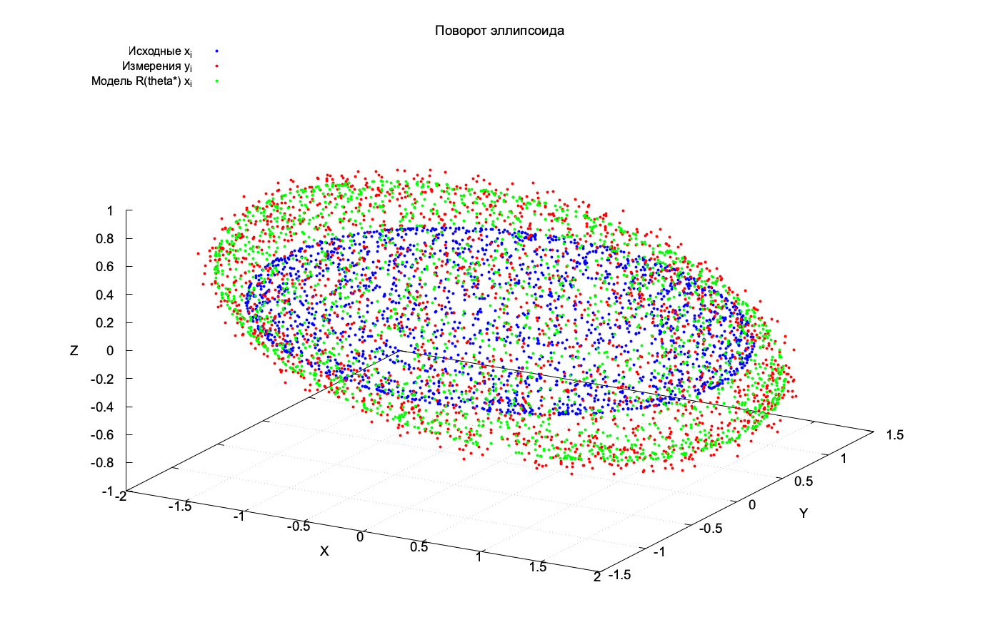
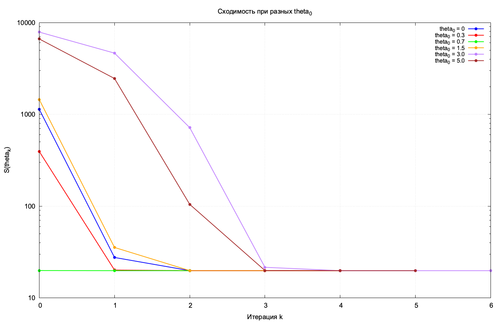

**Вывод формулы Родрига**

**Облако точек**

**График сходимости целевой функции S(θₖ) по итерациям**

**Сходимость при разных θ₀**
| θ₀ | θ* | S* | iters | conv |
| :--- | :--- | :--- | :--- | :--- |
| 0.3 | 0.700753 | 19.8891 | 5 | yes |
| 0.7 | 0.700753 | 19.8891 | 3 | yes |
| 1.5 | 0.700753 | 19.8891 | 5 | yes |
| 3.0 | 0.700753 | 19.8891 | 7 | yes |
| 5.0 | 6.98394 | 19.8891 | 6 | yes |

